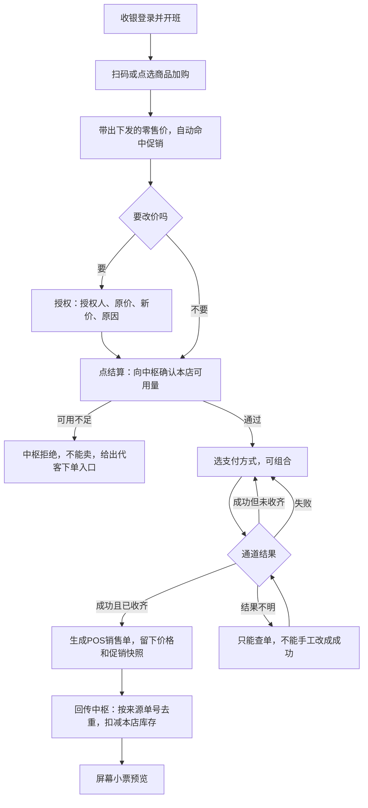
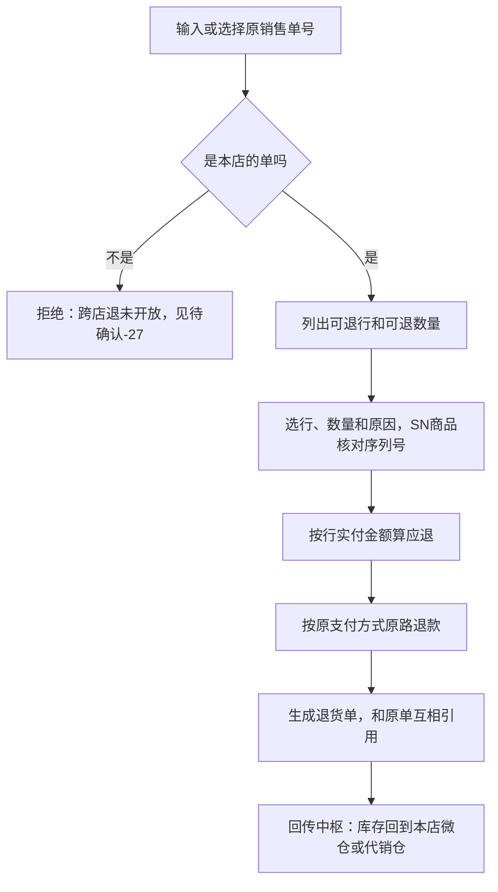
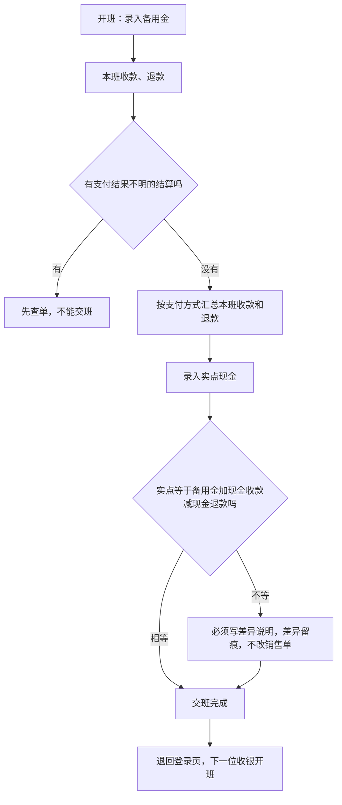
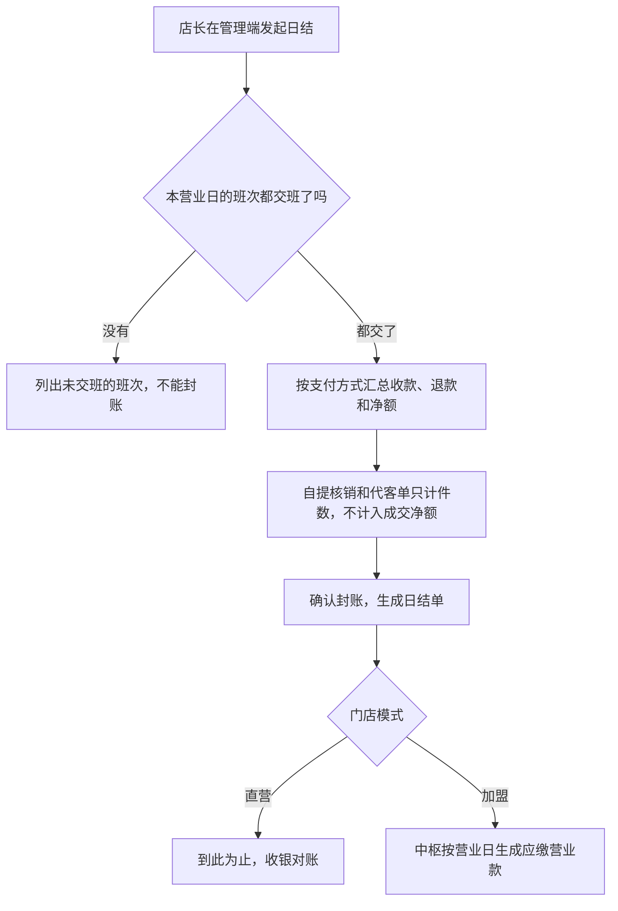
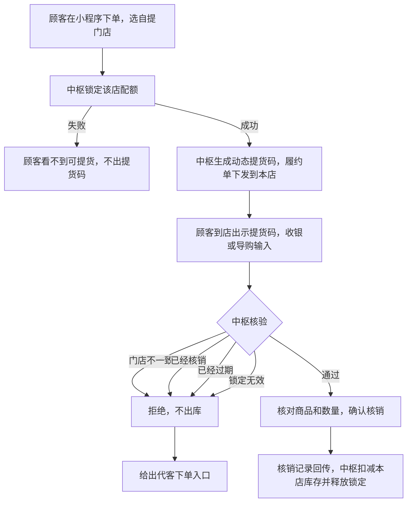
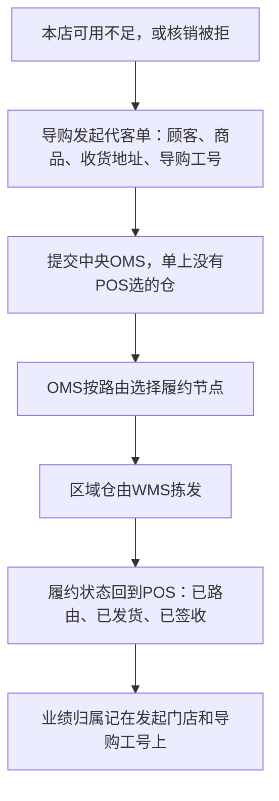
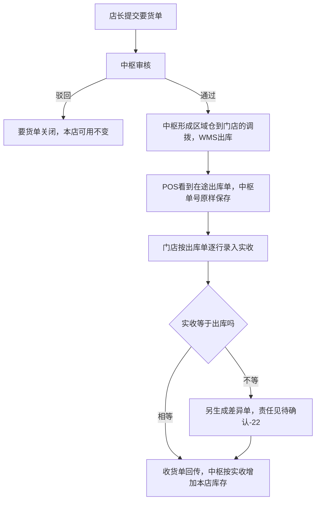
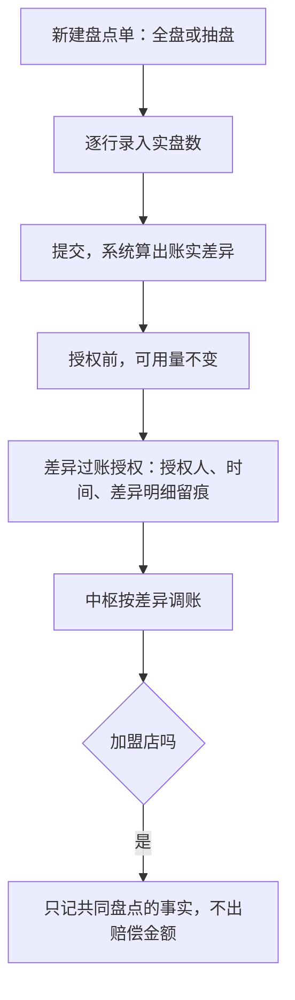
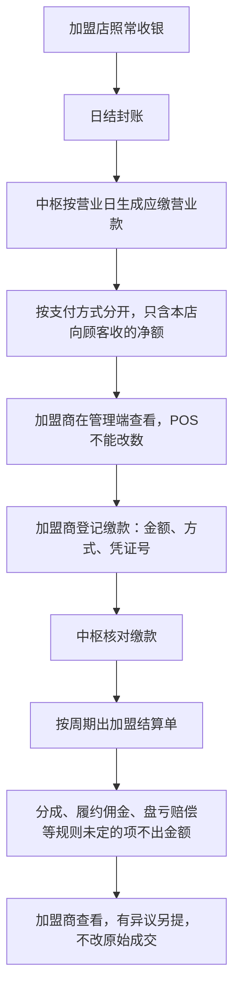

# 强盛POS前端原型设计说明

> 更新日期：2026-10-15。
>
> 本文是`09-产品原型`的实现约定，回答三个端有哪些菜单和页面、核心流程在原型里怎么走、演示账号能看什么、视觉怎么定、代码放在哪。业务口径以[01全局背景信息](../01-全局背景信息/)为准，冲突时改原型，不改01。
>
> 本文不是04产品设计方案。原型里的状态名、字段、按钮、单号前缀和演示假设都只用于演示，不能回写成规则。全部数据是mock，不接支付、中枢、金蝶和外设，不做离线。演示能走通只证明流程表达，不证明通道和中枢已经联调，见[阶段规划§四](../01-全局背景信息/10.阶段规划与一期交付标准.md)。

---

## 一、原型要演示什么

一期的五个场景和阶段5的三个场景来自[阶段规划](../01-全局背景信息/10.阶段规划与一期交付标准.md)。原型按下表取舍。

| 场景 | 原型里怎么演示 | 涉及的端 |
| --- | --- | --- |
| 进店卖出一件现货，只扣一次 | 收银开单，结算前向中枢确认可用量，支付后回传。销售单详情里点「模拟重复回传」，中枢按来源单号去重，库存不再扣 | 收银、管理 |
| 小程序自提不会到店扑空 | 中枢模拟器生成自提单，锁定成功才出提货码。收银端或手机核销。门店不一致、已核销、已过期、锁定无效都会被拒。进店销售卖不到已锁定的件数 | 收银、移动、管理 |
| 现场没有货，用单据代发 | 开单时可用不足，或核销被拒，转代客下单，单上带门店和导购工号。OMS路由结果和履约状态回到POS。POS不选仓、不选承运商 | 收银、移动、管理 |
| 断网卖掉的不是第二笔 | 不做离线，本次已确认不做。去重只用「模拟重复回传」演示 | 管理 |
| 要货收货和盘点对得上锁库 | 要货提交后可用不变。中枢发运后显示在途。按来源出库单收货，短少另成差异单。盘点差异授权前不改可用，授权后由中枢调账 | 移动、管理 |
| 加盟店卖出，货和款各自归位 | 加盟店用同一套收银。日结封账后，中枢生成应缴营业款，按支付方式分开，不含线上已付款的订单。POS只读 | 收银、管理 |
| 加盟店被选为自提点 | 加盟店核销，锁的是该店代销仓，店里不再收钱。履约佣金不出金额，见【待确认-20】 | 收银、移动 |
| 抽一笔店内交易往下看原单 | 交易追溯页：销售单、支付流水、班次、日结、中枢结果单号。凭证节点灰显，注明在金蝶 | 管理 |

---

## 二、三个端

| 端 | 入口文件 | 使用者 | 设备和尺寸 | UI库 |
| --- | --- | --- | --- | --- |
| 管理端 | `admin.html` | 总部运营、财务、店长、加盟商管理和财务、系统管理 | PC，1440×900起 | Naive UI |
| 收银端 | `cashier.html` | 收银、导购、店长 | 收银机横屏，1366×768为基线，适配到1920×1080。全屏、大按钮、大字号 | Naive UI |
| 移动端 | `mobile.html` | 店长、导购 | 手机H5，宽375至430 | Vant 4 |
| 演示入口 | `index.html` | 演示人员 | PC | 不用UI库 |

三个端读写同一份浏览器本地mock数据。在一个端做的动作，另外两个端刷新或切回页面后就能看到。

---

## 三、菜单与页面清单

「范围」沿用[项目背景§三](../01-全局背景信息/2.强盛科技POS项目的背景信息.md)：一期是直营交易和店务，阶段5是加盟、商场报送和审计抽样。「原型」一列：可操作是能走完交互；只读是只展示；占位是只放说明，不做交互。

### 3.1 收银端

左侧导航：收银、自提核销、代客下单、退货、交易、交班。顶栏显示门店、收银台、班次、操作员和中枢连接状态。

| 页面 | 路由 | 做什么 | 范围 | 原型 |
| --- | --- | --- | --- | --- |
| 登录与开班 | `/login` | 选门店和收银台，工号加演示PIN登录。本人有未交班的班次就直接进入，否则录入备用金开班 | 一期 | 可操作 |
| 收银开单 | `/sale` | 扫码或搜索加购，改数量，SN商品逐件采集序列号，选导购工号，识别会员和用券，自动计算促销并列出命中项，改价走授权，挂单和取单 | 一期 | 可操作 |
| 结算支付 | `/pay` | 结算前向中枢确认可用量。现金、微信、支付宝、银联卡，可组合。结果不明只能查单。储值和积分抵扣置灰 | 一期 | 可操作 |
| 成交小票 | `/done/:no` | 成交结果和屏幕小票预览。单号旁标「演示前缀」 | 一期 | 可操作 |
| 自提核销 | `/pickup` | 输入提货码，由中枢核验门店、锁定、有效期和是否已核销。通过则确认核销并回传。被拒时给代客下单入口 | 一期 | 可操作 |
| 代客下单 | `/agent` | 从购物车或被拒的核销带入商品。填顾客、收货地址、导购工号，提交中央OMS。看今日代客单的履约状态 | 一期 | 可操作 |
| 退货 | `/return` | 按原销售单退：选行和数量，按原支付方式退款。无原单退和跨店退不开放 | 一期 | 可操作 |
| 交易查询 | `/orders` | 本班和当日的销售、退货，看明细 | 一期 | 可操作 |
| 交班 | `/handover` | 按支付方式汇总本班，录入实点现金，差异必须写说明。交班后退回登录页 | 一期 | 可操作 |

### 3.2 移动端

底部标签：工作台、履约、库存、我的。

| 页面 | 路由 | 做什么 | 范围 | 原型 |
| --- | --- | --- | --- | --- |
| 工作台 | `/home` | 本店今日概况、待办和快捷入口 | 一期 | 可操作 |
| 自提核销 | `/pickup` | 输入提货码，核验后核销 | 一期 | 可操作 |
| 履约 | `/fulfil` | 本店待核销自提和代客单。顾客信息脱敏 | 一期 | 可操作 |
| 代客下单 | `/agent/new` | 选商品，填顾客和地址，提交OMS | 一期 | 可操作 |
| 库存查询 | `/stock` | 本店可用、锁定、在途 | 一期 | 只读 |
| 库存详情 | `/stock/:sku` | 单品数量和本店库存流水 | 一期 | 只读 |
| 要货 | `/replenish`、`/replenish/new` | 要货单列表和新建 | 一期 | 可操作 |
| 收货 | `/receive`、`/receive/:no` | 在途出库单列表，按出库单逐行录入实收 | 一期 | 可操作 |
| 盘点 | `/stocktake`、`/stocktake/:no` | 新建盘点，录入实盘，提交差异 | 一期 | 可操作 |
| 退仓 | `/return-wh` | 退仓单列表和新建 | 一期 | 可操作 |
| 我的业绩 | `/performance` | 本人工号的成交归属和代客单归属。不显示提成金额 | 一期 | 只读 |
| 门店日报 | `/daily` | 本店当日按支付方式的汇总和日结状态 | 一期 | 只读 |
| 我的 | `/me` | 切换演示身份，重置演示数据 | 演示 | 可操作 |

### 3.3 管理端

左侧菜单按下面的分组。菜单项随演示身份的权限显示或隐藏。

| 分组 | 页面 | 路由 | 做什么 | 范围 | 原型 |
| --- | --- | --- | --- | --- | --- |
| 工作台 | 工作台 | `/dashboard` | 授权范围内的今日成交、支付构成、门店排行、履约和店务待办、中枢回传状态 | 一期 | 只读 |
| 门店交易 | 销售单 | `/sales` | 列表筛选；详情含行明细、促销快照、改价留痕、支付流水、导购归属、回传状态和追溯链 | 一期 | 可操作 |
| | 退货单 | `/returns` | 列表和详情，引用原销售单 | 一期 | 只读 |
| | 支付流水 | `/payments` | 按通道和状态查流水，原样展示通道流水号 | 一期 | 只读 |
| 到店履约 | 自提履约单 | `/pickups` | OMS下发到店的履约单投影和核销记录，含被拒记录 | 一期 | 只读 |
| | 代客单 | `/agent-orders` | 代客单和OMS回来的履约状态、导购归属 | 一期 | 只读 |
| 门店店务 | 要货单 | `/replenishments` | 列表、详情、新建 | 一期 | 可操作 |
| | 收货与差异 | `/receipts` | 在途出库单、收货单、差异单 | 一期 | 只读 |
| | 盘点单 | `/stocktakes` | 列表、详情，差异过账授权 | 一期 | 可操作 |
| | 退仓单 | `/return-warehouse` | 列表和详情 | 一期 | 只读 |
| | 店间调拨 | `/transfers` | 只放说明：是否允许见【待确认-26】，未允许前不列入一期必做 | 待确认 | 占位 |
| 门店库存 | 门店库存 | `/inventory` | 按店按SKU看中枢投影的账面、锁定、可用、在途 | 一期 | 只读 |
| 班次日结 | 班次 | `/shifts` | 班次列表、交班汇总和现金差异 | 一期 | 只读 |
| | 日结 | `/daily-close` | 营业日封账：检查班次，按支付方式汇总，确认封账 | 一期 | 可操作 |
| 加盟结算 | 应缴营业款 | `/franchise/dues` | 中枢按营业日生成的应缴，按支付方式分开。POS只读 | 阶段5 | 只读 |
| | 缴款登记 | `/franchise/remittances` | 加盟商登记缴款，中枢核对 | 阶段5 | 可操作 |
| | 加盟结算单 | `/franchise/settlements` | 结算单只读，规则未定的项不出金额，可以提异议 | 阶段5 | 可操作 |
| 主数据 | 门店 | `/master/stores` | 门店档案、经营模式、库存位置。加盟店显示三条已确认常量，其余合同配置留空 | 一期 | 只读 |
| | 商品与价格 | `/master/products` | SKU、条码、零售价、是否采集SN。不展示成本 | 一期 | 只读 |
| | 促销 | `/master/promotions` | 下发到店的促销和券。来源系统见【待确认-46】 | 一期 | 只读 |
| | 导购与员工 | `/master/staff` | 工号、姓名、职责、所属门店 | 一期 | 只读 |
| 审计 | 操作日志 | `/audit/logs` | 必须留痕的动作，带操作者、时间、对象、前后值 | 一期 | 只读 |
| | 交易追溯 | `/audit/trace` | 输入销售单号或提货码，向下串出整条链 | 阶段5 | 可操作 |
| 系统 | 角色与数据范围 | `/system/roles` | 职责和功能矩阵、演示账号的数据范围 | 一期 | 只读 |
| | 中枢模拟器 | `/system/hub` | 演示工具，模拟中枢、OMS和WMS的动作，不属于POS | 演示 | 可操作 |

---

## 四、核心流程

每个流程后面列出原型必须守住的检查点。检查点的依据写在括号里。

### 4.1 收银开单与支付



- 本次数量不得大于中枢给的可用量，可用量等于账面减去自提锁定。中枢拒绝之后不能改成本地已售（[全局规则§二](../01-全局背景信息/4.强盛POS全局业务规则与约束.md)）。
- 成交价取下发价格加成交时命中的促销，销售单留快照。事后改主数据不改历史单（全局规则§五）。
- 改价要授权，留下授权人、原价、新价和原因。授权层级见【待确认-51】。
- 结果不明按通道查单，不能在POS里标成成功（全局规则§三）。组合支付中途取消，已经成功的那部分原路退回，并留痕。
- 导购职责只开单、挂单，不收款；收款由收银职责完成（[角色权限§一](../01-全局背景信息/8.角色权限原则.md)）。演示账号可以兼岗。
- 导购工号写在单头和每一行上，作为业绩归属的主键。

### 4.2 退货



- 退货单引用原单，换货用退货单加新销售单表达（[单据目录§二](../01-全局背景信息/5.强盛POS的单据目录与分层.md)）。
- 组合支付先退哪一种见【待确认-08】。原型按支付先后倒序原路退，并标成演示假设。
- 日结封账后的更正走退货，不改已封账的原单（全局规则§六）。
- 无原单退货要另行授权，原型不开放。线上订单到店退由中枢按原渠道退款，原型未做。质量问题的期限见【待确认-30】，原型不校验天数。

### 4.3 交接班



- 交班只核对这一班的支付方式和现金。差异留下，不在交班时改写销售单（全局规则§六）。
- 差异超过多少要升级处理见【待确认-10】。原型只要求非零差异必须写说明，不设阈值。

### 4.4 日结



- 日结不是凭证。封账后这一营业日的成交不能改（[上下游链路§五](../01-全局背景信息/3.强盛POS的定义和上下游链路.md)、全局规则§六）。
- 切日时点见【待确认-10】，原型按自然日。日结由谁执行、封账前要满足什么条件见【待确认-55】，原型由店长执行，前置条件是班次都已交班。
- 核销金额不加进门店成交额。核销是否另生零金额销售单见【待确认-14】（上下游链路§3.2）。
- 重开已封账的日结要另行授权，原型不开放。

### 4.5 自提核销



- 没有锁定成功的记录不核销出库。同一提货码再次扫描不得再次扣减（全局规则§二）。
- POS不生成提货码，也不改履约单的商品和数量（[上下游链路§3.2](../01-全局背景信息/3.强盛POS的定义和上下游链路.md)）。
- 核销不再收钱。加盟店核销锁的是该店代销仓，履约佣金见【待确认-20】（[模式说明§2.3](../01-全局背景信息/7.直营与加盟代销模式说明.md)）。
- 提货截止、部分提货、取消后释放见【待确认-04】，无码核销见【待确认-05】，原型都不做。提货码的位数和刷新频率留给后续设计。
- 核销成功和被拒都写操作日志。

### 4.6 代客下单与代发



- 代客单是申请，不是发货指令。POS不指定仓库、库位和承运商（[上下游链路§五](../01-全局背景信息/3.强盛POS的定义和上下游链路.md)）。页面只展示OMS给的路由结果。
- 代发不扣本店库存，扣减发生在被路由选中的节点（全局规则§二）。
- 先占库还是先收款见【待确认-06】，原型不在POS收款，只提交和看状态。承运商见【待确认-47】，演示数据只出现叙事里的顺丰。
- 提成不在POS里算，见【待确认-13】。

### 4.7 要货与收货



- 要货单是申请，审核前和在途期间本店可用都不变，收货回传后才增加（全局规则§二）。
- 审核人和安全库存天数见【待确认-48】。原型由中枢模拟器审核和发运，不在POS里审核。
- 实收输入框不预填出库数，不能把实收改成和出库一致来做平（全局规则§四）。
- 加盟店要货走同一条调拨，不产生货款，不做资金校验（模式说明§2.1）。
- 门店要货是否包含直送、直通，超期未收怎么处理，见【待确认-41】，原型不做。

### 4.8 盘点



- 盘点差异授权之前不改变可售数量，授权之后由中枢调整（全局规则§二）。授权层级见【待确认-51】。
- 盘点期间是否停售、抽盘差多少算通过，见【待确认-15】。原型不停售，页面上提示。
- 加盟店盘亏的损耗率、计价和判责见【待确认-23】，系统不自动生成赔偿金额（全局规则§四）。
- POS盘点单不直接推送金蝶（单据目录§三）。

### 4.9 退仓和店间调拨

退仓：店里提交退仓单，写明商品、数量和原因，交给中枢处理，原型由中枢模拟器推进状态。加盟店的残次、滞销、质量件也走退仓，只转移库存位置，不返货款（模式说明§2.1）。

店间调拨：直营与加盟之间、加盟店之间是否允许调拨见【待确认-26】，未允许前不列入一期必做（单据目录§二）。管理端只放占位页，写明没有单据的调货不改变任何一边的可用量（全局规则§四）。

### 4.10 加盟营业款结算（阶段5）



- 应缴不含线上已付款、只到店核销或由本店代发的订单（模式说明§2.2）。
- POS不让店员在日结时扣下分成，分成等结算单（全局规则§六）。
- 商户号见【待确认-16】，上缴全额还是净额见【待确认-17】，分成口径见【待确认-18】，结算周期见【待确认-19】，履约佣金见【待确认-20】，结算单放在中枢还是金蝶见【待确认-38】，保证金见【待确认-33】。
- 储值消费不进加盟应缴，见【待确认-21】。原型不做储值。

---

## 五、角色与权限

### 5.1 职责和数据范围

角色名称、菜单和审批层级都没有定稿（[角色权限原则](../01-全局背景信息/8.角色权限原则.md)）。原型按职责建演示角色，演示账号再按兼岗组合职责。兼岗不扩大数据范围。

| 职责 | 能进的端 | 数据范围 |
| --- | --- | --- |
| 导购 | 收银、移动 | 本店 |
| 收银 | 收银 | 本店 |
| 店长 | 收银、移动、管理 | 本店 |
| 总部运营 | 管理 | 被明确授权的直营店，授权到店 |
| 财务 | 管理 | 被授权的店的日结和支付流水；加盟应缴和结算要按加盟商单独授权 |
| 加盟商管理 | 管理 | 本加盟商名下的店、代销仓、应缴和结算 |
| 加盟商财务 | 管理 | 同加盟商管理 |
| 系统管理 | 管理 | 账号和数据范围的配置，主数据和日志只读 |

所有端都不展示存货成本和供应商价格。列表不展示核销用不到的顾客字段，手机号一律脱敏，见【待确认-52】。

### 5.2 功能矩阵

「办」是可以操作；「看」是只读；「授」是可以发起，但要授权人确认后才能完成；「-」是不可见。谁能当授权人、授权到哪一层见【待确认-51】，原型里由本店店长和被授权的总部运营担任。

| 功能 | 导购 | 收银 | 店长 | 总部运营 | 财务 | 加盟商管理 | 加盟商财务 | 系统管理 |
| --- | --- | --- | --- | --- | --- | --- | --- | --- |
| 开单、挂单、取单 | 办 | - | - | - | - | - | - | - |
| 会员识别、用券 | 办 | 办 | - | - | - | - | - | - |
| 改价 | 授 | 授 | - | - | - | - | - | - |
| 收款、查单 | - | 办 | - | - | - | - | - | - |
| 有原单退货、退款 | - | 办 | - | - | - | - | - | - |
| 无原单退货、反结账 | - | 授 | - | - | - | - | - | - |
| 自提核销 | 办 | - | - | - | - | - | - | - |
| 代客下单 | 办 | - | - | - | - | - | - | - |
| 本人业绩归属 | 看 | - | - | - | - | - | - | - |
| 交班 | - | 办 | - | - | - | - | - | - |
| 日结封账 | - | - | 办 | - | - | - | - | - |
| 要货、收货、退仓 | - | - | 办 | 看 | - | 看 | - | - |
| 盘点录入和提交 | - | - | 办 | 看 | - | 看 | - | - |
| 盘点差异过账 | - | - | 授 | - | - | - | - | - |
| 担任授权人（改价、盘点差异过账） | - | - | 办 | 办 | - | - | - | - |
| 门店库存（可用、锁定、在途） | 看 | 看 | 看 | 看 | - | 看 | - | - |
| 销售单、退货单、支付流水 | - | 看 | 看 | 看 | 看 | 看 | 看 | - |
| 自提履约单、代客单 | 看 | - | 看 | 看 | - | 看 | - | - |
| 班次、日结 | - | - | 看 | 看 | 看 | 看 | 看 | - |
| 应缴营业款 | - | - | - | - | 看 | 看 | 看 | - |
| 缴款登记 | - | - | - | - | 看 | 办 | 办 | - |
| 加盟结算单、提异议 | - | - | - | - | 看 | 办 | 办 | - |
| 查看全部加盟商结算 | - | - | - | - | 授 | - | - | - |
| 主数据 | - | - | 看 | 看 | 看 | 看 | 看 | 看 |
| 操作日志、交易追溯 | - | - | 看 | 看 | 看 | 看 | 看 | 看 |
| 账号与数据范围 | - | - | - | - | - | - | - | 办 |

- 跨店退、修改已封账日结、离线开关在原型里都不开放。跨店退见【待确认-27】。
- 有菜单权限也不能绕过「中枢拒绝锁库则不能卖」。系统管理可以授权，不能改数据（角色权限§五）。
- 中枢模拟器是演示工具，不计入权限。

### 5.3 演示账号

姓名都是演示数据，不对应背景里的人物。背景人物只帮助理解参与方，不映射账号（[项目背景§六](../01-全局背景信息/2.强盛科技POS项目的背景信息.md)）。演示PIN统一是`1234`。

| 工号 | 姓名 | 职责组合 | 数据范围 |
| --- | --- | --- | --- |
| QS1001 | 王海 | 店长、收银、导购 | 万象天地店 |
| QS1002 | 李雨桐 | 收银、导购 | 万象天地店 |
| QS1003 | 张一鸣 | 导购 | 万象天地店 |
| QS2001 | 刘佳 | 店长、收银、导购 | 科技园店 |
| QS9001 | 陈思远 | 总部运营 | 万象天地店、科技园店 |
| QS9002 | 周静 | 财务 | 万象天地店、科技园店；加盟商甲、乙已单独授权 |
| SYS001 | 林晓 | 系统管理 | 账号和数据范围 |
| JMA001 | 赵磊 | 加盟商管理 | 加盟商甲：松山湖店 |
| JMA002 | 吴婷 | 加盟商财务 | 加盟商甲：松山湖店 |
| JMA101 | 孙浩 | 店长、收银、导购（加盟商员工） | 松山湖店 |
| JMB001 | 何欣 | 加盟商管理 | 加盟商乙：千灯湖店 |
| JMB101 | 郑凯 | 店长、收银、导购（加盟商员工） | 千灯湖店 |

---

## 六、原型里的演示假设

背景没有给出、原型又必须取一个值才能跑通的地方，统一登记在`src/shared/config/assumptions.ts`，页面上显示「演示假设」标记。假设值不能写回01成为规则（阶段规划§2.4）。

| 事项 | 原型的做法 | 依据或待确认 |
| --- | --- | --- |
| 促销叠加 | 同一行的特价和第N件折扣取优惠大的一个；整单满减取最优的一个；每单最多一张券；改价最后算 | 【待确认-53】，来源系统【待确认-46】 |
| 优惠分摊和舍入 | 整单优惠按行金额比例分摊到分，尾差用最大余数法分配 | 【待确认-53】 |
| 部分退货应退 | 按该行实付金额乘退货数量比例，退完最后一件时吸收尾差 | 【待确认-53】 |
| 组合支付的退款顺序 | 按支付先后倒序原路退 | 【待确认-08】 |
| 券和积分 | 券按满额减；积分只显示余额，不抵扣，也不累计 | 【待确认-54】 |
| 会员范围 | 只能识别本店会员，不跨店共享 | 【待确认-37】 |
| 营业日 | 按自然日切日 | 【待确认-10】 |
| 交班差异 | 非零差异必须写说明，不设升级阈值 | 【待确认-10】 |
| 日结执行人 | 店长，前置条件是班次都已交班 | 【待确认-55】 |
| 授权人 | 本店店长和被授权的总部运营可以授权；不拦截本人授权本人 | 【待确认-51】 |
| 盘点期间 | 不停售，页面提示 | 【待确认-15】 |
| 提货截止 | 不计算截止时间，只展示中枢给的「已过期」 | 【待确认-04】 |
| 代客单收款 | 不在POS收款 | 【待确认-06】 |
| 承运商 | 演示数据只出现顺丰 | 【待确认-47】 |
| 要货审核 | 在中枢模拟器里审核，调出仓由中枢给出 | 【待确认-48】 |
| 在途短少 | 只生成差异单，不判责 | 【待确认-22】 |
| SN采集 | 演示商品里部分标成「需采集SN」 | 【待确认-11】 |
| 单号 | 用[编码规则§1.2](../01-全局背景信息/6.强盛POS的编码规则和通用字段规则.md)的建议前缀，页面标「演示前缀」 | 【待确认-01】 |
| 中枢结果单号 | 用`HUB`开头的演示号，不代表ERP单据类型 | 【待确认-01】【待确认-14】 |
| 门店名册 | 两家直营、两家加盟，都是演示数据。万象天地店沿用叙事店名 | 【待确认-42】【待确认-50】 |
| 门店编码 | 上游下发，原型用`DEMO01`这类占位码 | 【待确认-42】 |
| 结算周期 | 演示结算单取10月1日至14日，只为展示版式 | 【待确认-19】 |

背景已经确认、原型直接照做的：直营和加盟两种店，加盟为代销，货权在强盛，营业款由门店收取后结算归集，加盟店参与自提和代发路由；锁库、路由、业财、主数据在中枢；单价4位小数、金额2位小数；带编码的主数据按Code-Name展示；空值显示`-`；时间按北京时间。

---

## 七、视觉规范

### 7.1 定位

强盛的ERP和WMS用React＋shadcn＋Tailwind，JXC用React＋Tailwind手写组件，SRM用React＋Mantine，主色都是蓝色系。POS走零售门店的方向：深青做底，闪电黄点睛，暖橙只表示优惠。三个端共用一套色板，管理端偏信息密度，收银端偏触控和远看，移动端偏单手操作。

| 对比项 | 其他强盛项目 | POS |
| --- | --- | --- |
| 主色 | 蓝色系 | 深青`#0B7A6E` |
| 侧栏或顶栏 | 近黑中性色、浅色 | 深青墨`#0C2624`，选中项用闪电黄标记 |
| 圆角 | 小圆角、直角 | 管理端10px，卡片14px，收银端按钮14至18px |
| 字号 | 12px紧凑 | 管理端14px，收银端16至20px，金额用大号等宽数字 |
| 图标 | Lucide、Tabler | Phosphor |

### 7.2 色板

色值放在`src/shared/theme/tokens.ts`。Naive UI和Vant的主题都从这里取，页面不硬编码颜色。

| 用途 | 名称 | 色值 | 说明 |
| --- | --- | --- | --- |
| 主色 | brand-600 | `#0B7A6E` | 主按钮、链接、选中态。白字对比度约5.4:1 |
| 主色悬停 | brand-500 | `#0E8F80` | |
| 主色按下 | brand-700 | `#0A6359` | |
| 主色浅底 | brand-50 | `#E8F6F4` | 选中行、浅色标签 |
| 深色底 | ink-900 | `#0C2624` | 管理端侧栏、收银端顶栏 |
| 点睛 | volt-400 | `#FFD43B` | 侧栏选中标记、收银端「结算」按钮。只配深色字 |
| 优惠 | promo-500 | `#F0532A` | 促销标签、优惠金额 |
| 成功 | success | `#16A34A` | 已完成、已核销、中枢已接受 |
| 警示 | warning | `#D97706` | 待处理、在途、演示假设 |
| 错误 | error | `#DC2626` | 拒绝、差异、失败 |
| 信息 | info | `#2563EB` | 已提交、处理中 |
| 画布 | canvas | `#F3F6F5` | 页面底色 |
| 正文 | text-1 | `#10201F` | |
| 次要文字 | text-2 | `#4A5B59` | |
| 弱文字 | text-3 | `#7A8A88` | 只用于占位和辅助说明 |
| 边线 | line | `#E2E8E6` | |

### 7.3 字体和数字

- 中文用系统字体栈：PingFang SC、HarmonyOS Sans SC、Noto Sans SC、Microsoft YaHei。
- 数字和金额用Barlow并开启等宽数字，收银端的应收金额最大可到48px。
- 金额统一`¥1,234.00`：2位小数、千分位。单价4位小数，见编码规则§二。数量是整数。
- 时间`YYYY-MM-DD HH:mm:ss`，日期`YYYY-MM-DD`，北京时间。

### 7.4 各端尺寸

| 项 | 管理端 | 收银端 | 移动端 |
| --- | --- | --- | --- |
| 正文字号 | 14px | 16px，关键信息20px起 | 14至15px |
| 控件高度 | 34px | 48px，主操作64至72px | Vant默认，主按钮48px |
| 触控目标 | 不要求 | 不小于56×56px | 不小于44×44px |
| 布局 | 左侧菜单232px，顶栏56px，内容区卡片 | 左侧导航88px，顶栏56px，左商品右购物车 | 顶部导航、底部标签、卡片分组 |

### 7.5 组件用法

- 管理端：列表用`n-data-table`，筛选放在卡片顶部一行；详情用抽屉或独立页；状态用`StatusTag`；金额用`MoneyText`；授权用`AuthorizeModal`。
- 收银端：商品用大卡片网格；数量用大号步进器；金额输入用屏幕数字键盘；结算是右下角最大的按钮；提示用顶部大号通知，不用小气泡。
- 移动端：页面用`van-nav-bar`加`van-cell-group inset`；列表用卡片；录入用`van-stepper`和`van-field`；提交按钮固定在底部。

### 7.6 文案和标记

- 全部中文，用词以[术语表](../01-全局背景信息/11.术语表.md)为准。例如写「代客下单」「核销」「应缴营业款」，不写「下单发货」「验券」「分账」。
- 成交金额写「成交净额」，不写「收入」。POS不把已经收款写成已经确认收入（[合规与审计§三](../01-全局背景信息/9.合规与审计要求.md)）。
- 带编码的主数据按Code-Name展示，例如`LWH000101 万象天地店门店微仓`。空值一律`-`。
- 待确认项用`PendingTag`，样式是琥珀色虚线框加编号，悬停显示缺口说明。编号和说明来自`src/shared/config/pending.ts`，与[待对齐事项](../01-全局背景信息/12.待对齐事项.md)一致。
- 演示假设用灰色「演示假设」标记，单号旁用「演示前缀」标记，各端顶栏有「演示数据」标记。

---

## 八、技术方案与目录结构

### 8.1 技术栈

| 层 | 选型 | 说明 |
| --- | --- | --- |
| 框架 | Vue 3.5、TypeScript 5.9 | 已与用户确认 |
| 构建 | Vite 8，多页面入口 | 一个工程，`admin.html`、`cashier.html`、`mobile.html`和`index.html`四个入口 |
| 组件库 | Naive UI 2.45（管理端、收银端），Vant 4.10（移动端） | 由`unplugin-vue-components`按需引入，组件类型写在`src/components.d.ts` |
| 样式 | UnoCSS 66，Phosphor图标 | 图标写成`i-ph-xxx`类名 |
| 状态 | Pinia 3 | 端内会话、购物车、挂单 |
| 路由 | Vue Router 4.6，hash模式 | 多页面入口不需要服务端回退配置 |
| Mock | 本地mock层 | 见8.3 |
| 测试 | Vitest | 价格促销、分摊、退款、编号和规则检查 |
| 截图 | playwright-core加本机Chrome | `npm run screenshots` |

Mock选本地层而不用MSW：三个入口是三个页面，要共用同一份数据，localStorage最直接；不需要注册Service Worker；以后换真实接口，只替换`src/shared/api`里的实现。

Pinia和Vue Router没有用最新的大版本，用的是API最稳定、资料最多的版本，方便以后维护。

### 8.2 目录结构

```text
09-产品原型/
├── AGENTS.md                 原型目录的开工须知
├── 前端设计说明.md            本文
├── 待改项.md                  没做完和已知差异
├── index.html                演示入口
├── admin.html                管理端入口
├── cashier.html              收银端入口
├── mobile.html               移动端入口
├── package.json
├── vite.config.ts
├── uno.config.ts
├── tsconfig*.json
├── scripts/
│   └── screenshots.mjs       三端截图脚本
└── src/
    ├── components.d.ts       组件库自动引入生成的类型
    ├── shared/               三端共用
    │   ├── types/            商品、门店、会员、订单、履约、店务、班次、加盟、日志等类型
    │   ├── config/           待确认清单、演示假设、职责与权限、状态文案
    │   ├── domain/           价格促销计算、退款、单号、规则检查（带单测）
    │   ├── mock/             种子数据、本地库、中枢模拟、支付模拟
    │   ├── api/              页面唯一的数据入口
    │   ├── composables/      useRequest等
    │   ├── utils/            金额、单价、时间、Code-Name、脱敏
    │   ├── theme/            色板和Naive、Vant主题
    │   ├── naive/            管理端和收银端共用的Naive组件
    │   └── styles/           全局样式
    └── apps/
        ├── admin/            管理端：layouts、pages、components、router
        ├── cashier/          收银端：pages、components、stores、router
        ├── mobile/           移动端：pages、components、router
        └── portal/           演示入口
```

### 8.3 Mock和中枢模拟

- `mock/db.ts`：一份本地库，存在localStorage的`qs-pos-demo`键里。第一次打开时按种子生成，刷新保留。其他标签页改了数据，会通过storage事件同步。
- `mock/seed/`：门店、员工、商品、促销、会员是手写的；过去7天和今天上午的销售、班次、日结、应缴由生成器按固定随机种子生成，金额走同一套价格计算，所以各处数字对得上。
- `mock/hub.ts`：模拟中枢。负责可用量确认、成交和退货扣减、按来源单号去重、自提锁定和核销、代客单路由、要货审核和发运、收货入账、盘点调账、日结后生成加盟应缴、缴款核对。POS页面不能直接调用，只经过`api`。
- `mock/payment.ts`：模拟支付通道。收银端可以把下一笔的结果设成成功、结果不明或失败，用来演示查单。
- 管理端的「中枢模拟器」把这些中枢动作做成按钮，并提供「重置演示数据」。

### 8.4 共享计算

- `domain/pricing.ts`：输入购物车行、促销、券和改价，输出每行的原价金额、促销优惠、整单优惠分摊、券分摊、改价和实付，以及命中促销的快照。
- `domain/refund.ts`：部分退货的应退金额，退款在原支付方式之间的分配。
- `domain/numbering.ts`：`{前缀}-{YYYYMMDD}-{序号}`，同类型同一天从0001起，超过9999扩成5位。
- `domain/rules.ts`：可卖检查、核销核验、交班差异、日结前置条件等，返回带依据的提示文字。
- 金额在代码里一律用整数分，展示时再格式化。

### 8.5 怎么运行

```bash
cd 09-产品原型
npm install
npm run dev          # 打开 http://localhost:5173/ 进入演示入口
npm run typecheck
npm test
npm run build
npm run screenshots  # 需要先 npm run dev 或 npm run preview
```

---

## 九、没有做的部分

见[待改项](待改项.md)。主要是：离线和外设按用户要求不做；真实支付、中枢、金蝶不联调；无原单退货、跨店退、线上订单到店退、反结账、日结重开、商场报送、电子发票、储值、积分抵扣、店间调拨、提成计算都不做，其中多数挂着【待确认】。

---

## 十、原型引用的【待确认】

编号和缺口说明以[待对齐事项§三](../01-全局背景信息/12.待对齐事项.md)为准。【待确认-53】【待确认-54】【待确认-55】是这次做原型时发现的新缺口，已经补进索引。

| 编号 | 原型里出现在哪 |
| --- | --- |
| 【待确认-01】 | 所有POS单号旁的「演示前缀」，中枢结果单号，收银台编号 |
| 【待确认-04】 | 自提履约单的截止时间，核销页 |
| 【待确认-05】 | 核销页不提供无码核销 |
| 【待确认-06】 | 代客下单页的收款说明 |
| 【待确认-08】 | 退货页的退款顺序 |
| 【待确认-10】 | 交班差异、日结切日 |
| 【待确认-11】 | 商品的SN标记，开单和退货的SN采集 |
| 【待确认-13】 | 我的业绩、导购归属、退货对业绩的影响 |
| 【待确认-14】 | 核销不计入成交净额，追溯链 |
| 【待确认-15】 | 盘点页的停售提示 |
| 【待确认-16】至【待确认-20】 | 门店档案的加盟合同配置，应缴营业款，加盟结算单 |
| 【待确认-21】 | 支付页的储值置灰 |
| 【待确认-22】 | 差异单的责任，代销仓建仓粒度 |
| 【待确认-23】 | 加盟店盘点、结算单的盘亏赔偿 |
| 【待确认-24】【待确认-25】 | 门店档案的铺货额度，加盟商的区域仓可订量 |
| 【待确认-26】 | 店间调拨占位页 |
| 【待确认-27】 | 退货页的跨店退 |
| 【待确认-30】 | 退货页的质量问题期限 |
| 【待确认-31】 | 小票上的发票说明 |
| 【待确认-33】【待确认-34】【待确认-35】 | 门店档案的保证金和备案、价格带、经营权 |
| 【待确认-37】 | 会员识别范围 |
| 【待确认-38】 | 加盟结算单的存放位置 |
| 【待确认-40】 | 支付页的通道说明 |
| 【待确认-41】【待确认-48】 | 要货页 |
| 【待确认-42】【待确认-50】 | 门店名册和演示数据说明 |
| 【待确认-46】 | 促销页和收银端的促销来源 |
| 【待确认-47】 | 代客单的承运商 |
| 【待确认-51】 | 授权弹窗 |
| 【待确认-52】 | 履约列表的手机号脱敏 |
| 【待确认-53】 | 价格促销计算、优惠分摊、部分退货应退 |
| 【待确认-54】 | 用券、积分 |
| 【待确认-55】 | 日结执行人和前置条件 |
